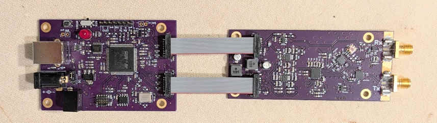
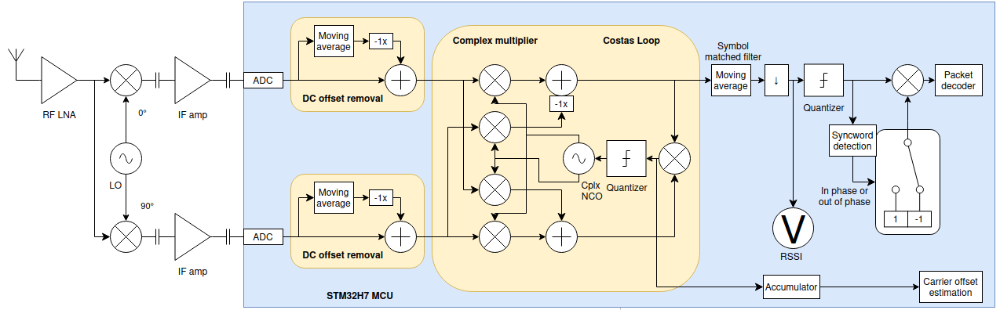
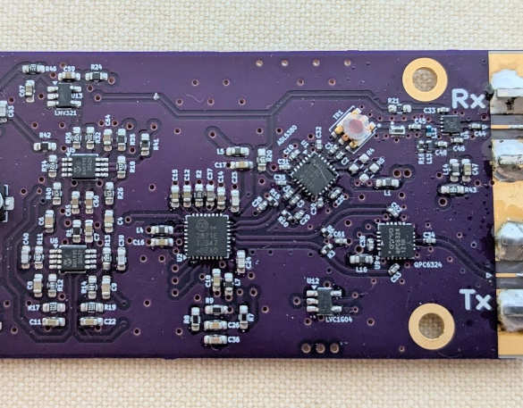
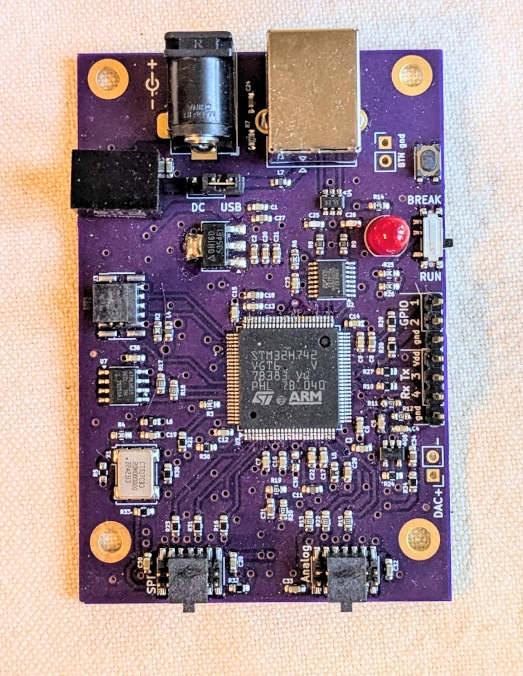

# 400 MHz - 6 GHz BPSK RF Transceiver

## Zero-IF receiver

Block Diagram ([DSP code](https://github.com/szoftveres/RF_instruments/blob/main/dsp_stm32H7/Src/bpsk_transceiver.c)):

One of the most common problem with zero-IF receivers is the mixer DC offset, and the theoretical necessity of DC coupling the baseband signal all the way from the mixer to the ADC, through high-gain IF stages, which results in an inherent DC overload of the IF amplifier chain and the ADCs. [This very inspirational artcle](https://s53mv.s56g.net/archive/p024.pdf) describes a zero-IF receiver that has AC-coupled IF stages and subsequent AC-coupled digitizer. The main idea is that as long as the transmitter makes sure that the received baseband I and Q signals have plenty of AC (and almost no DC) content, AC coupling in the receiving IF stages is possible, assuming that the lowest frequencies of the baseband signal are still well above the AC low cutoff frequency of the IF chain. Enhancing AC content of the transmitted data is done by [scrambling (whitening)](https://en.wikipedia.org/wiki/Scrambler), which is un-done at the receiver side by a de-scrambler. 

Since the received signal has an inevitable carrier offset (Tx and Rx clock crystal frequency mismatch and drift), a [Costas-loop](https://en.wikipedia.org/wiki/Costas_loop) de-rotates the baseband signal in the receiver. A Costas-loop has two stable states and is able to track slow phase drift (due to carrier mismatch) up to a certain slew-rate (and hence, up to a certain carrier mismatch). State change happens due to an abrupt phase switch by 180° that the Costas-loop is unable to track. Hence, the preceding IF stages must support a high slew rate.

In this receiver, the sampling rate is 160ksps and the Costas-loop has a phase angle resolution of 22.5° (1/16 of a full circle), hence it can track up to +/- 10 kHz carrier offset; The MAX2871 PLL can be tuned in 10 kHz steps, so link can be established as long as the receiver is tuned to either of the adjacent frequencies of a transmitter's mismatched carrier.
The IF stages have a low cutoff frequency of ~200 Hz and a max. bandwidth of 1 MHz, allowing very quick transitions. The total IF gain is ~40 dB.

The integral of the Costas-loop NCO control signal is directly related to the phase angle rotation speed of the incoming carrier, hence it can be direclty used to calculate the Tx/Rx carrier offset, in absolute +/- Hz value.

**[-->> RF board schematics <<--](schem.pdf)**

## BPSK Transmitter

Instead of using a conventional RF mixer, an SPDT RF switch (Qorvo QPC6324, toggled by the MCU) is connected to one of the differential pair outputs of the main RF signal source (MAX2871 PLL), and selects between the in-phase or out-of-phase version of the RF carrier, depending on the modulation bit (1 or 0). This primitive BPSK modulation method was chosen because of its simplicity and availability of cheap parts, as well as due to general unavailability of broadband, low-power- or low LO level upconverting mixers (ADL5375 would be a good candidate, except for its 200mA supply requirment). For good I/Q balance at the highest carrier frequencies, the differential pair RF PCB traces must be length-matched between the RF source and the two inputs of the RF switch.

## DSP Microcontroller

The design of the DSP/MCU board is covered [here](https://github.com/szoftveres/RF_instruments/tree/main/dsp_stm32H7).

