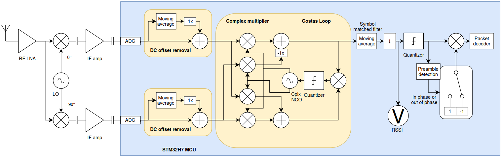

# Zero-IF BPSK transceiver, 400 MHz - 6 GHz

One of the most common problem with zero-IF receivers is the mixer DC offset and the theoretical necessity of DC coupling the baseband signal all the way from the mixer to the ADC through high-gain IF stages, which results in an inherent DC overload of the IF amplifier chain and the ADCs. A very inspirational [artcle](https://s53mv.s56g.net/archive/p024.pdf) describes a zero-IF receiver that has AC-coupled IF stages and subsequent AC-coupled digitizer. The main idea is that the transmitter makes sure that the received I and Q signals never linger at DC levels longer than just several symbols, by the means of scrambling (whitening) the transmitted signal, thereby enabling AC coupling in the receiver. Only the low cutoff frequency of the AC coupling must be chosen carefully.

Since the received signal has an inevitable carrier offset (Tx and Rx clock crystal frequency mismatch), a [Costas-loop](https://en.wikipedia.org/wiki/Costas_loop) de-rotates the baseband signal in the receiver. A Costas-loop has two stable states and is able to track slow phase drift (due to carrier mismatch) up to a certain slew-rate (and hence, up to a certain carrier mismatch). The loop changes state when the phase of the received signal abruptly changes by 180° (Tx symbol phase transition) that the Costas-loop cannot track. Hence, it is required that the preceding IF stages support a high slew rate.

In this receiver, the Costas-loop can track +/- 10 kHz carrier offset; the IF stages have a low cutoff frequency of ~200 Hz and a max. bandwidth of 1 MHz, allowing very quick transitions. The total IF gain is ~40 dB.

**[-->> RF board schematics <<--](schem.pdf)**

Functional Block Diagram ([DSP code](https://github.com/szoftveres/RF_instruments/blob/main/dsp_stm32H7/Src/bpsk_transceiver.c)):

